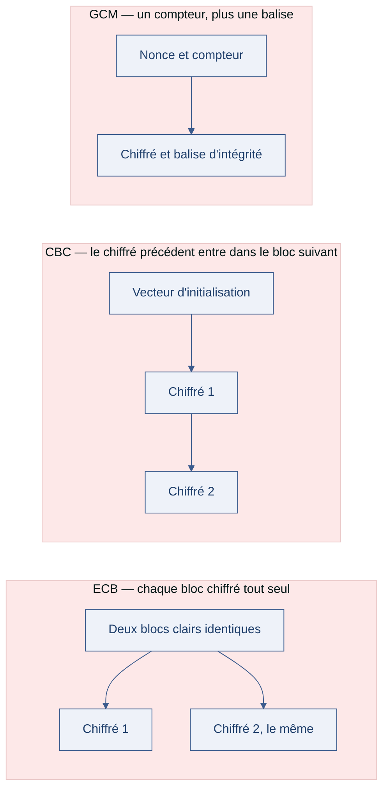

[← Chapitre précédent](01-histoire-et-services.md) · [Sommaire](Readme.md) · [Chapitre suivant →](03-chiffrement-asymetrique.md)

# Du chiffre de César à AES

> César envoie ses ordres par des messagers qu'il ne choisit pas toujours. Pour qu'un
> message intercepté ne livre rien, il décale chaque lettre d'un nombre fixe de rangs.
> Le procédé tient tant que l'ennemi ignore le décalage — et il ne tient pas longtemps.
> De cette idée est né tout le chiffrement symétrique, jusqu'à AES.

**Durée de lecture :** 50 min hors approfondissements facultatifs · **Prérequis :** [Histoire et services de la cryptographie](01-histoire-et-services.md)

---

## Objectifs

À l'issue de ce chapitre, vous serez capable de :

- **Chiffrer** un message court avec le chiffre de César, puis **le casser** par force brute.
- **Expliquer** pourquoi la fréquence des lettres ruine les chiffrements par substitution.
- **Distinguer** un chiffrement par flot d'un chiffrement par blocs, et **nommer** les modes ECB, CBC et GCM.
- **Justifier** le rôle de la clé, du vecteur d'initialisation et du padding dans un chiffrement moderne.
- **Écarter** un générateur pseudo-aléatoire non adapté à la production de clés.

---

## I. Le chiffre de César

César (100-44 av. J.-C.) protège ses dépêches par un procédé d'une simplicité
désarmante : **décaler chaque lettre** d'un nombre fixe de rangs dans l'alphabet. Avec
un décalage de 3, A devient D, B devient E ; en fin d'alphabet on boucle — X devient A.
Si un messager est capturé, l'ennemi ne lit rien. La limite est déjà là : la clé est un
simple nombre, et il n'y en a pas beaucoup.

Le vocabulaire de cette époque est déjà celui d'aujourd'hui :

| Terme | Signification | Dans l'exemple de César |
| --- | --- | --- |
| Texte clair | Le message lisible | L'ordre transmis à la légion |
| Texte chiffré | Le message transformé | Le message décalé |
| Clé | Le secret partagé | Le nombre de rangs de décalage |
| Algorithme | La règle de transformation | Décaler chaque lettre de N rangs |

En Python, le décalage tient en quelques lignes :

```python
def cesar(texte, decalage):
    """Chiffre un message par décalage (lettres minuscules, reste inchangé)."""
    resultat = ""
    for lettre in texte:
        if "a" <= lettre <= "z":
            base = ord("a")
           # % 26 : on boucle en fin d'alphabet (x -> a, y -> b, z -> c)
            resultat += chr(base + (ord(lettre) - base + decalage) % 26)
        else:
            resultat += lettre # espaces et ponctuation sont conservés
    return resultat

print(cesar("veni vidi vici", 3))
```

L'exemple historique se lit ainsi :

```text
Texte clair   : VENI VIDI VICI
Décalage (clé): 3
Texte chiffré : YHQL YLGL YLFL
```

Le texte chiffré est inintelligible — pour peu que le destinataire connaisse la clé.

> [!TIP]
> Un chiffrement ne cache rien tant que la clé est connue de l'adversaire. La
> question n'est jamais « mon texte est-il transformé ? » mais « ma clé est-elle
> restée secrète ? ».

### Casser César

Une clé qui ne prend que 25 valeurs ne résiste pas à l'énumération : on essaie les 25
décalages et on garde le résultat compréhensible. C'est l'attaque par **force brute** —
tester toutes les clés possibles — et elle prend une fraction de seconde.

```python
def casser_cesar(texte_chiffre):
    """Affiche les 25 décalages possibles : la bonne clé se repère à l'œil."""
    for cle in range(1, 26):
        print(cle, cesar(texte_chiffre, -cle))
```

> 🔁 **Pour aller plus loin (facultatif)** — à lire si le créneau le permet, rien
> d'obligatoire n'en dépend : la manipulation est faite en grand, et de bout en bout,
> dans l'exercice 1 « Casser le chiffre de César », un peu plus bas dans ce
> chapitre.
>
> **Atelier César (10 min)**
>
> 1. Reprenez la fonction `cesar` et chiffrez une phrase de votre choix avec le
> décalage 3.
> 2. Lancez `casser_cesar` sur votre message chiffré.
> 3. Repérez la bonne clé à l'œil, puis notez le nombre d'essais nécessaires.

La leçon est brutale : **la robustesse se mesure au nombre de clés possibles**. Avec 25
clés, l'attaquant les essaie toutes ; il faudra un espace de clés rendant l'énumération
impossible.

---

### Exercice 1 — Casser le chiffre de César (30 min)

#### Contexte

**Transports Delmas**, une PME (petite et moyenne entreprise) de transport routier, organise ses tournées par de
courts messages entre la réception et les chauffeurs : « le camion passe à midi »,
« quai nord », etc. Pour qu'un message lu par-dessus l'épaule ne livre rien, les
équipes utilisent un chiffrement par décalage — le chiffre de César — avec une clé
changée chaque semaine.

Cette semaine, la clé est **7**. Un message a été intercepté sur un parking :

```text
sl jhtpvu whzzl h tpkp
```

Vous disposez du code de départ ci-dessous, qui ne fait encore rien d'utile.

```python
def chiffrer(texte, cle):
    """Chiffre un message par décalage (lettres minuscules, reste inchangé)."""
    return texte  # à compléter
```

Quelques repères pour ne pas partir dans le décor : l'alphabet en compte **26**
lettres, et le décalage **26** ramène au texte clair — il n'y a donc que **25**
décalages utiles à essayer pour casser un message.

#### Consignes

##### Partie 1 — Chiffrer et déchiffrer

1. Complétez `chiffrer(texte, cle)` : chaque lettre minuscule est décalée de `cle`
   rangs dans l'alphabet, en bouclant en fin d'alphabet (x devient a, y devient b, z
   devient c). Les espaces et la ponctuation sont conservés tels quels.
2. Écrivez `dechiffrer(texte, cle)`, qui retrouve le texte clair. Faites en sorte de
   **réutiliser** `chiffrer` plutôt que de recopier la logique.
3. Chiffrez le message `le camion passe a midi` avec la clé 7, puis vérifiez que
   `dechiffrer` le restitue exactement.

##### Partie 2 — Casser par force brute

1. Écrivez `casser(texte_chiffre)` : la fonction affiche les **25** décalages
   possibles (clés de **1** à **25**), chacun précédé de la clé testée.
2. Lancez-la sur le message intercepté `sl jhtpvu whzzl h tpkp`.
3. Identifiez la clé qui donne un français lisible, et notez le message retrouvé.

##### Partie 3 — Expliquer la limite de César

En trois phrases au maximum, expliquez pourquoi ce chiffrement ne protège rien dès
que l'adversaire a le message chiffré. Votre réponse doit mentionner **la taille de
l'espace des clés** et **ce que le texte chiffré laisse encore deviner**.

##### Partie 4 — Relier à la cryptographie moderne

Un collègue affirme : « il suffit d'augmenter le décalage pour rendre le chiffre
solide ». Répondez-lui en deux phrases, puis nommez les deux propriétés d'un
chiffrement moderne comme AES (Advanced Encryption Standard) qui répondent
précisément à ce que César ne protège pas.

#### Attendu

- Un script Python contenant `chiffrer`, `dechiffrer` et `casser`, exécutable de bout
  en bout.
- Le message clair retrouvé pour le message intercepté.
- Deux réponses courtes écrites (parties 3 et 4).

#### Vérification

Vous avez réussi quand :

- `dechiffrer(chiffrer(texte, 7), 7)` renvoie `texte` pour n'importe quelle phrase en
  minuscules ;
- `casser` affiche bien 25 lignes, dont une seule est lisible ;
- votre explication de la partie 3 cite le nombre de clés possibles ;
- votre réponse de la partie 4 nomme une propriété liée à la **clé** et une liée au
  **texte chiffré**.

#### ✅ Auto-évaluation

Avant de passer au corrigé, vérifiez que :

- [ ] J'ai implémenté `chiffrer` et `dechiffrer` sans recopier deux fois la même logique.
- [ ] Mon aller-retour chiffrement / déchiffrement restitue le texte d'origine.
- [ ] J'ai affiché les 25 décalages et repéré la bonne clé à l'œil.
- [ ] J'ai expliqué pourquoi la force brute suffit à casser César.
- [ ] J'ai relié cette faiblesse à une propriété d'un chiffrement moderne.

#### Prolongement de l'exercice

*Facultatif.* Modifiez `chiffrer` pour qu'elle conserve aussi les majuscules, puis
pour qu'elle accepte un décalage négatif sans changer de signature. Vérifiez que
`dechiffrer` fonctionne toujours.

<details>
<summary>Voir la correction</summary>

#### Partie 1 — Chiffrer et déchiffrer

**Éléments attendus :**

```python
def chiffrer(texte, cle):
    """Chiffre un message par décalage (lettres minuscules, reste inchangé)."""
    resultat = ""
    for lettre in texte:
        if "a" <= lettre <= "z":
            base = ord("a")
            # % 26 : on boucle en fin d'alphabet (x -> a, y -> b, z -> c)
            resultat += chr(base + (ord(lettre) - base + cle) % 26)
        else:
            resultat += lettre  # espaces et ponctuation sont conservés
    return resultat

def dechiffrer(texte, cle):
    """Retrouve le texte clair : déchiffrer, c'est chiffrer en sens inverse."""
    return chiffrer(texte, -cle)
```

Vérification demandée :

```python
clair = "le camion passe a midi"
chiffre = chiffrer(clair, 7)
print(chiffre)                  # sl jhtpvu whzzl h tpkp
print(dechiffrer(chiffre, 7))   # le camion passe a midi
```

**Ce qu'il faut retenir :** `dechiffrer` ne contient aucune logique propre. Un
décalage de `-cle` dans un alphabet de 26 lettres est exactement l'opération inverse —
c'est la définition même d'un chiffrement réversible. Recopier la boucle une deuxième
fois, c'est doubler le risque d'erreur.

**Erreurs fréquentes :**

- Oublier le modulo `% 26` : les lettres de fin d'alphabet sortent de l'alphabet et
  donnent des caractères bizarres.
- Écrire `ord(lettre) + cle` sans retirer `base` puis le remettre : le calcul décale
  alors le code du caractère, pas la lettre dans l'alphabet.
- Traiter les espaces comme des lettres : le message se déforme et ne se relit plus.

#### Partie 2 — Casser par force brute

**Éléments attendus :**

```python
def casser(texte_chiffre):
    """Affiche les 25 décalages possibles : la bonne clé se repère à l'œil."""
    for cle in range(1, 26):
        print(cle, chiffrer(texte_chiffre, -cle))
```

Exécution sur le message intercepté (extrait) :

```text
1  rk igsout vgyyk g sojo
...
7  le camion passe a midi
...
25 tm kiuqwv xiaam i uqlq
```

La clé est **7**, et le message est **le camion passe a midi**.

**Ce qu'il faut retenir :** l'attaque ne demande aucune clé, aucun secret, aucune
hypothèse sur le contenu — seulement la patience d'essayer les 25 possibilités et un
œil pour reconnaître le français. C'est la définition d'une attaque par force brute.

**Erreurs fréquentes :**

- Boucler de 0 à 25 inclus : la clé 26 redonne le texte chiffré lui-même, ce qui fait
  26 lignes au lieu de 25 et noie la bonne réponse.
- Afficher les résultats sans la clé testée : impossible de la rapporter ensuite.
- Chercher la réponse « au hasard » plutôt que de parcourir systématiquement les
  clés — la force brute est justement une énumération complète.

#### Partie 3 — Expliquer la limite de César

**Éléments attendus :**

Le chiffre de César ne protège pas deux choses. D'abord la clé : il n'existe que 25
décalages utiles, donc un adversaire qui a le message chiffré les essaie tous en une
fraction de seconde. Ensuite le texte lui-même : les mots restent séparés par les
mêmes espaces, les mots de même longueur gardent la même forme, et la fréquence des
lettres du chiffré reproduit celle du français — simplement décalée.

**Ce qu'il faut retenir :** la question n'est pas « le texte est-il transformé ? »
mais « combien de clés faut-il essayer, et qu'est-ce que le chiffré laisse encore
voir ? ». César échoue sur les deux tableaux.

#### Partie 4 — Relier à la cryptographie moderne

**Éléments attendus :**

Augmenter le décalage ne change rien : il y a toujours 25 décalages à essayer, et
l'analyse de fréquence fonctionne quelle que soit la valeur choisie. Un chiffrement
comme AES (Advanced Encryption Standard) répond aux deux faiblesses : sa clé est
tirée dans un espace si vaste que la force brute ne le parcourt pas, et sa
transformation ne laisse filtrer ni les fréquences, ni les répétitions, ni la longueur
des mots.

**Sur la formulation :** « plus c'est compliqué, plus c'est sûr » est un réflexe
naturel et faux. La sécurité se mesure : taille de l'espace des clés, et quantité
d'information que le chiffré divulgue. Un chiffrement simple et bien conçu bat un
chiffrement compliqué et mal conçu.

#### Points à retenir

- Un chiffrement symétrique repose sur **une clé partagée** et une transformation
  réversible — déchiffrer, c'est chiffrer en sens inverse.
- La robustesse se juge d'abord à la **taille de l'espace des clés** : 25 clés
  possibles, c'est zéro secret.
- Un chiffré divulgue encore des **structures** (espaces, longueurs, fréquences) :
  les casser ne demande pas de clé.
- AES corrige les deux points : espace des clés immense, et aucune structure du texte
  clair visible dans le texte chiffré.

</details>

---

## II. La substitution mono-alphabétique

L'étape suivante, dès l'Antiquité, donne **à chaque lettre sa propre image** : A
devient M, B devient T, C devient R… C'est la substitution mono-alphabétique — une
seule table de correspondance pour tout le message. L'espace des clés explose : environ
4 × 10^26 façons d'associer 26 lettres entre elles, bien au-delà de l'énumérable.

Et pourtant ce chiffrement tombe aussi, par une attaque qui ne s'intéresse plus aux
clés mais au **langage** : dans un texte français, le « E » est de loin la lettre la
plus fréquente, suivi du « A », du « S », du « I »… En comparant la distribution des
lettres du chiffré à celle du français, on retrouve la table sans jamais l'avoir
connue. C'est l'**analyse de fréquence**, décrite dès le IXe siècle par Al-Kindi.

> 🔁 **Pour aller plus loin (facultatif)** — à lire si le créneau le permet, rien
> d'obligatoire n'en dépend. Le comptage confirme d'un coup d'œil ce que l'explication
> ci-dessus énonce : la substitution conserve les fréquences.
>
> **Atelier comptage de fréquences (8 min)**
>
> 1. Prenez un paragraphe d'une trentaine de lignes (un article, un courriel, un
> chapitre de ce cours).
> 2. Comptez l'apparition de chaque lettre, par exemple avec un dictionnaire Python :
> `compte[lettre] = compte.get(lettre, 0) + 1`.
> 3. Triez les lettres par fréquence décroissante. Le « E » arrive-t-il en tête ?
> 4. Refaites le comptage sur un texte chiffré par substitution : la forme de la
> distribution est la même, seuls les noms des lettres ont changé.

Ce qui a tué la substitution n'est pas un calcul plus rapide, c'est une **propriété du
texte** que le chiffrement laisse passer. D'où le principe directeur de toute la
cryptographie moderne : un bon chiffrement ne doit laisser filtrer **aucune** structure
du clair — ni fréquences, ni longueur, ni répétitions.

> [!WARNING]
> Chiffrer ne rend pas un message indétectable : sa longueur, son destinataire et son
> horodatage restent visibles. La cryptographie protège le contenu, pas la
> conversation.

---

## III. La cryptographie moderne : AES

Ces méthodes sont dérisoires face aux besoins d'aujourd'hui. Deux idées ont fait
basculer la cryptographie dans l'ère moderne.

**Première idée : des clés qu'on ne peut pas énumérer.** AES (Advanced Encryption
Standard), adopté en 2001, travaille sur des blocs de 128 bits avec des clés de 128,
192 ou 256 bits. Une clé de 128 bits, c'est 2^128 clés possibles — un nombre suivi de
38 zéros : à un milliard de clés par seconde, l'énumération prendrait plus de temps que
l'âge de l'univers. La force brute n'est plus une option ; la sécurité repose sur le
secret de la clé, pas sur l'ignorance de l'algorithme.

**Deuxième idée : chiffrer par blocs, et donc choisir un mode.** AES transforme des
blocs de 16 octets ; un fichier plus long est découpé, et la façon d'assembler les blocs
s'appelle le **mode de chiffrement** :

| Mode | Principe | À retenir |
| --- | --- | --- |
| ECB (Electronic Codebook) | Chaque bloc est chiffré indépendamment, avec la même clé | Deux blocs identiques donnent le même chiffré : les motifs réapparaissent. **À proscrire.** |
| CBC (Cipher Block Chaining) | Chaque bloc est mélangé avec le chiffré du bloc précédent | Les motifs disparaissent ; exige un vecteur d'initialisation et un padding. |
| GCM (Galois/Counter Mode) | Chiffrement par compteur, plus une vérification d'intégrité | Chiffre **et** authentifie en une passe. Le mode à préférer aujourd'hui. |

CBC exige des blocs de même taille : on complète le dernier avec du **padding** (des
octets de remplissage dont la valeur encode la longueur ajoutée). GCM travaille en
flot : il combine une suite de bits avec le message, sans complétion.

Le tableau ci-dessus dit ce que chaque mode **est**. Le schéma ci-dessous montre ce qui
**entre dans le bloc** — et c'est ce qui explique pourquoi ECB répète et pourquoi CBC
propage.



Rien n'entre dans un bloc ECB, c'est ce qui le rend répétitif. Tout y entre en CBC, par la
chaîne des chiffrés successifs. GCM ne mélange pas les blocs entre eux : il produit une
suite dépendante du nonce et ajoute la balise qui authentifie.

### La clé, le vecteur d'initialisation et le hasard

Deux valeurs entrent en jeu, et on les confond souvent :

- **La clé** est le secret : tirée au hasard, gardée secrète, changée quand elle ne
  l'est plus. Une clé devinable ou réutilisée partout annule tout le reste.
- **Le vecteur d'initialisation** (IV, *initialization vector*) est la valeur de départ
  qui fait diverger deux chiffrements faits avec la même clé. Il doit être **aléatoire
  et jamais réutilisé**, mais pas secret : il voyage avec le message, en clair.

> [!DANGER]
> Réutiliser le même IV avec la même clé est une erreur classique et grave : en GCM,
> elle ruine à la fois la confidentialité et l'authentification. En CBC, elle laisse
> apparaître des correspondances entre messages. Quand un IV est tiré au hasard, on le
> stocke à côté du chiffré ; quand il est séquentiel, on garantit qu'il ne se répète
> jamais.

### D'où vient le hasard ?

Un ordinateur est **déterministe** : à mêmes entrées, mêmes sorties. Le hasard y est
donc simulé à partir d'une **graine** (*seed*) qui détermine toute la suite. Même
graine, même suite — pratique pour les tests, fatal pour la cryptographie.

> 🧪 **Atelier aléatoire et graine (10 min)**
>
> 1. Exécutez ce fragment, puis relancez-le à l'identique :
>
> ```python
> import random
>
> random.seed(42) # graine fixée : la suite est reproductible
> print([random.randint(0, 99) for _ in range(5)])
> ```
>
> 2. Constatez que la suite est **toujours la même**, puis remplacez par le module
> `secrets`, conçu pour la cryptographie :
>
> ```python
> import secrets
>
> print(secrets.token_bytes(16)) # 16 octets imprévisibles
> ```
>
> 3. Relancez : chaque exécution produit une valeur différente.

Le module `random` de Python est un générateur pseudo-aléatoire, ou PRNG (
*Pseudo-Random Number Generator*) : sa sortie se reconstitue dès qu'on connaît la
graine. La cryptographie exige un PRNG **cryptographiquement sûr**, ou CSPRNG
(*Cryptographically Secure Pseudo-Random Number Generator*) — `secrets`, `os.urandom`.
Une graine prévisible, c'est une clé devinable.

> [!TIP]
> En révision de code, le réflexe est simple : toute apparition de `random` dans un
> module qui touche aux clés, aux jetons ou aux mots de passe est un défaut. La bonne
> bibliothèque est `secrets` (ou `os.urandom`), sans exception.

---

## IV. Aller plus loin

*Ces approfondissements sont facultatifs : ils ne sont jamais exigés pour terminer la
journée.*

- **Enigma et la machine de Turing** : pendant la Seconde Guerre mondiale, la machine
  Enigma chiffrait les communications allemandes avec un alphabet de substitution qui
  changeait à chaque frappe. L'équipe d'Alan Turing à Bletchley Park l'a cassée en
  exploitant à la fois des faiblesses de conception et des habitudes des opérateurs. La
  leçon vaut encore : la meilleure algorithmique ne résiste pas à une mauvaise
  implémentation.
- **Les autres modes de bloc** : CTR (Counter) transforme un chiffrement par blocs en
  chiffrement par flot et se parallélise ; CFB (Cipher Feedback) et OFB (Output Feedback) sont des variantes historiques.
  Le choix d'un mode se fait sur les recommandations à jour de l'ANSSI (Agence
  nationale de la sécurité des systèmes d'information), jamais sur une habitude.
- **L'analyse de fréquence, en pratique** : quelques dizaines de lignes de Python
  suffisent pour casser une substitution sur un texte suffisamment long. C'est un
  excellent exercice pour mesurer ce qu'un chiffrement laisse filtrer.
- **Chiffrement par flot contre chiffrement par blocs** : le premier combine le message
  avec une suite de bits générée (comme en GCM), le second transforme des blocs fixes
  (comme en CBC). Les deux coexistent parce qu'ils ne répondent pas aux mêmes contraintes
  de mise en œuvre.

---

## Points clés

- César donne le principe de tout chiffrement symétrique : **transformation
  réversible, gouvernée par une clé partagée**.
- Espace des clés trop petit, le chiffrement tombe à la **force brute** ; structures
  visibles, il tombe à l'**analyse statistique**.
- AES, 128 bits et plus : énumérer les clés n'est plus une option, la sécurité repose
  sur le **secret de la clé**.
- Le **mode** assemble les blocs : ECB est à proscrire, GCM chiffre **et** authentifie.
- **Clé** aléatoire et secrète ; **vecteur d'initialisation** aléatoire, jamais
  réutilisé, non secret. Hasard : **CSPRNG** (`secrets`), jamais `random`.

---

## 🧠 Vérifiez vos acquis

*Formatif, jamais noté. Répondez sans relire le chapitre, puis dépliez « Vérifier ses réponses ». Ce qui compte est de repérer où vous vacillez, pas de faire 5 sur 5.*

**1.** Pourquoi le chiffre de César cède-t-il en une fraction de seconde ?

- A. Parce que l'algorithme est secret et mal documenté
- B. Parce que la clé ne prend que 25 valeurs : on les essaie toutes
- C. Parce que les lettres françaises ont une fréquence caractéristique
- D. Parce que le décalage est inscrit dans le message chiffré

**2.** La substitution mono-alphabétique offre environ 4 × 10^26 clés possibles et tombe pourtant. Comment ?

- A. Par force brute, comme César : 4 × 10^26 clés, cela reste énumérable avec des machines modernes
- B. Par analyse de fréquence : le chiffrement laisse passer la structure de la langue
- C. Parce que la table de correspondance voyage avec le message et se lit donc dans le clair
- D. Parce qu'elle ne réutilise jamais la même image deux fois, ce qui rend le chiffré prévisible

**3.** Dans un fichier chiffré, deux portions identiques du clair produisent exactement le même texte chiffré : les motifs du document réapparaissent. Quel mode est en cause ?

- A. ECB, parce que chaque bloc est chiffré indépendamment avec la même clé
- B. CBC, parce que chaque bloc est mélangé avec le chiffré du bloc précédent
- C. GCM, parce qu'il travaille en flot
- D. Le padding, parce qu'il complète le dernier bloc

**4.** Pour gagner de la place, un module qui chiffre en AES-CBC réutilise le même vecteur d'initialisation (IV) sur tous les messages. Que faut-il en dire ?

- A. Aucun problème : l'IV n'a pas besoin d'être secret
- B. C'est un défaut : un IV qui se répète ruine un AES parfaitement configuré
- C. C'est souhaitable : un IV fixe rend le chiffrement déterministe, donc vérifiable
- D. Cela n'a d'effet que si la clé est trop courte

**5.** *Question ouverte (2-3 lignes).* Un module de l'application génère ses secrets de connexion avec `random`. Expliquez pourquoi c'est un défaut, ce qu'on met à la place, et ce que la graine (*seed*) a à voir là-dedans.

---

<details>
<summary>Vérifier ses réponses</summary>

### Réponses

**1. B.** La clé est un simple nombre de décalage : 25 valeurs, toutes essayables.
**Pourquoi :** c'est l'attaque par force brute, et la leçon du chapitre — la robustesse se mesure au **nombre de clés possibles**, pas à la sophistication de la règle.

**2. B.** L'analyse de fréquence ne s'intéresse pas aux clés mais au langage : en comparant la distribution des lettres du chiffré à celle du français, on retrouve la table sans l'avoir connue.
**Pourquoi :** ce qui a tué la substitution n'est pas un calcul plus rapide, c'est une propriété du texte que le chiffrement laisse filtrer — d'où le principe directeur : ne laisser filtrer **aucune** structure du clair.

**3. A.** C'est exactement le défaut d'ECB, et la raison pour laquelle ce mode est à proscrire.
**Pourquoi :** CBC mélange chaque bloc avec le chiffré du précédent (les motifs disparaissent) et GCM chiffre **et** authentifie en une passe — c'est le mode à préférer aujourd'hui.

**4. B.** Le chapitre est sans ambiguïté : un IV ou un nonce qui se répète ruine un AES parfaitement configuré — le hasard, ici, n'est pas un ornement.
**Pourquoi :** l'IV fait diverger deux chiffrements faits avec la même clé, et le cours oppose les deux rôles (la clé est le secret, l'IV la valeur de départ). Le chapitre sur les erreurs classiques enfonce le clou : un IV ou un nonce réutilisé avec la même clé révèle la relation entre deux messages et invalide l'authentification en GCM.

**5.** Attendu : `random` est un PRNG, un générateur pseudo-aléatoire dont la sortie se reconstitue dès qu'on connaît la graine ; on le remplace par `secrets` (ou `os.urandom`), un CSPRNG conçu pour la cryptographie. Une graine prévisible donne une suite prévisible, donc une clé devinable.
**Pourquoi :** un ordinateur est déterministe — à mêmes entrées, mêmes sorties ; même graine, même suite. C'est pratique pour les tests, fatal pour les clés.

</details>

---

[← Chapitre précédent](01-histoire-et-services.md) · [Sommaire](Readme.md) · [Chapitre suivant →](03-chiffrement-asymetrique.md)
