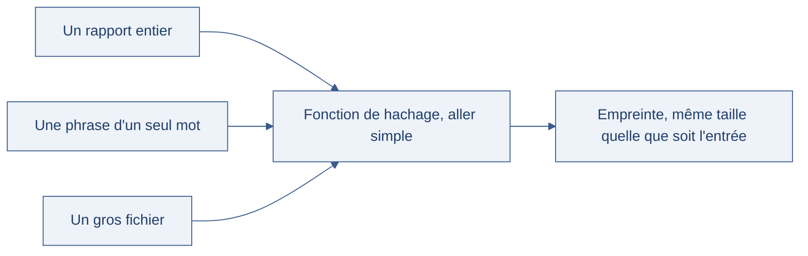

[← Chapitre précédent](03-chiffrement-asymetrique.md) · [Sommaire](Readme.md) · [Chapitre suivant →](05-erreurs-classiques.md)

# Le hachage et la signature numérique

> On scelle une lettre à la cire : le destinataire reconnaît le sceau, la cire montre
> si le pli a été ouvert, et l'expéditeur ne peut pas nier l'avoir envoyée. Trois
> garanties, un seul geste — les mêmes trois questions pour la cryptographie moderne,
> avec des empreintes et des signatures.

**Durée de lecture :** 45 min hors approfondissements facultatifs · **Prérequis :** [Histoire et services de la cryptographie](01-histoire-et-services.md)

---

## Objectifs

À l'issue de ce chapitre, vous serez capable de :

- **Calculer** l'empreinte d'un fichier et **détecter** la moindre modification.
- **Choisir** une fonction de hachage adaptée à un usage, et **écarter** les fonctions
  obsolètes.
- **Distinguer** une empreinte d'un code d'authentification à clé (HMAC).
- **Signer** un document et **vérifier** une signature, en expliquant ce que la
  signature apporte de plus qu'un hachage.
- **Relier** hachage, HMAC et signature aux trois questions : intact ? authentique ?
  prouvable ?

---

## I. Le hachage : l'empreinte numérique

Une **fonction de hachage** transforme un contenu de n'importe quelle longueur en une
empreinte de taille fixe, aussi appelée **condensat** ou *hash*. Changer un seul bit
change complètement l'empreinte, et c'est un aller simple : de l'empreinte on ne
revient pas au contenu.

Le schéma ci-dessous montre les deux propriétés que les mots ne font que déclarer : une
sortie de taille fixe quelle que soit l'entrée, et aucun chemin en sens inverse.



Les trois entrées n'ont pas la même masse, la sortie oui. Tout le chapitre tient dans
cette asymétrie : on compare des empreintes parce qu'elles sont courtes, comparables, et
sans retour possible vers ce qu'elles décrivent.

> 🧪 **Atelier rapide (8 min)**
>
> 1. Dans un terminal, hachez une phrase :
>
> ```bash
> echo -n "bonjour" | sha256sum
> ```
>
> 2. Notez l'empreinte obtenue.
> 3. Changez un seul caractère — `bonjour` devient `bonjouR` — et relancez. Comparez les
> deux empreintes : elles ne se ressemblent pas, alors qu'un seul caractère a bougé.
> 4. Relancez la première commande : l'empreinte est **toujours la même**. Le hachage
> est déterministe.

Une bonne fonction de hachage possède quatre propriétés :

| Propriété | Ce qu'elle garantit | Conséquence pratique |
| --- | --- | --- |
| Déterministe | Le même contenu donne toujours la même empreinte | On peut comparer deux empreintes à distance |
| Rapide à calculer | Le hachage d'un gros fichier reste instantané | Vérification systématique possible |
| À sens unique | On ne remonte pas de l'empreinte au contenu | L'empreinte ne révèle rien du fichier |
| Résistante aux collisions | On ne trouve pas deux contenus de même empreinte | Personne ne peut substituer un fichier sans changer l'empreinte |

### À quoi ça sert concrètement

- **Vérifier un téléchargement** : l'éditeur publie l'empreinte de son fichier, on
  recalcule et on compare après réception.
- **Vérifier une mise à jour** : le gestionnaire de paquets compare l'empreinte attendue
  et l'empreinte reçue avant d'installer.
- **Détecter une modification de données** : hacher chaque ligne d'un jeu de données
  repère un changement entre deux exports.

> [!TIP]
> Comparer des empreintes se fait sur la totalité de la valeur, jamais sur un extrait.
> Une empreinte tronquée perd sa résistance aux collisions : deux fichiers différents
> peuvent alors partager le même début d'empreinte.

### Quelles fonctions utiliser ?

Les fonctions SHA (Secure Hash Algorithm) ne se valent pas, et les plus anciennes sont
cassées :

| Fonction | Statut | À retenir |
| --- | --- | --- |
| MD5 | Cassée | Des collisions sont produites depuis des années : à proscrire, même pour vérifier un fichier. |
| SHA-1 | Cassée | Collision publiée en 2017 : ne plus l'utiliser pour de la sécurité. |
| SHA-2 (Secure Hash Algorithm, famille 2) | Recommandée | SHA-256 et SHA-512 sont le choix par défaut aujourd'hui. |
| SHA-3 (Secure Hash Algorithm, famille 3) | Recommandée | Autre construction, même niveau de sécurité : utile pour diversifier. |

**HMAC (Hash-based Message Authentication Code)** et signatures s'appuient sur ces
fonctions : le choix de la fonction conditionne la solidité de tout ce qui suit.

> [!DANGER]
> MD5 et SHA-1 ne sont pas « un peu faibles » : ils sont cassés au sens cryptographique,
> c'est-à-dire qu'on fabrique des collisions volontairement. Les employer pour
> authentifier un contenu, c'est accepter qu'un adversaire puisse en produire un autre de
> même empreinte.

---

## II. HMAC : authentifier un message avec une clé

Le hachage seul a un défaut : **n'importe qui** peut recalculer une empreinte. Qui
remplace le fichier remplace l'empreinte affichée à côté, et la comparaison reste bonne.
L'empreinte prouve l'intégrité d'un contenu par rapport à une valeur connue — pas
l'origine de cette valeur.

La réponse est d'ajouter une **clé** au hachage : c'est **HMAC**, qui mélange la clé et
le message de façon que :

- sans la clé, on ne peut pas produire un code valide pour un message donné ;
- deux messages différents donnent des codes sans rapport ;
- la vérification se fait avec la même clé, partagée entre l'émetteur et le
  destinataire.

```python
import hmac
import hashlib

cle = b"cle-partagee-entre-nous"
message = b"commande: 12 fromages"

code = hmac.new(cle, message, hashlib.sha256).hexdigest()
print(code)

# côté destinataire : on recalcule et on compare
attendu = hmac.new(cle, message, hashlib.sha256).hexdigest()
print(hmac.compare_digest(code, attendu))  # True
```

> [!WARNING]
> La comparaison des codes se fait avec `hmac.compare_digest`, jamais avec `==`. Une
> comparaison ordinaire s'arrête au premier caractère différent : en mesurant le temps
> de réponse, un attaquant reconstruit le code caractère par caractère. C'est une fuite
> par chronométrage (*timing attack*).

### HMAC ou hachage simple : le bon réflexe

| Besoin | Outil |
| --- | --- |
| Vérifier qu'un fichier téléchargé est le bon | Hachage simple, empreinte publiée par l'éditeur |
| Vérifier qu'un message vient d'un partenaire qui partage une clé | HMAC |
| Prouver l'origine devant un tiers | Signature numérique |

En pratique, HMAC protège les webhooks (le destinataire vérifie que la notification
vient bien de son partenaire), les jetons de session et les échanges entre services.

---

## III. La signature numérique

Reste la question la plus difficile : **prouver**. Le HMAC prouve que le message vient
de quelqu'un qui connaît la clé — mais la clé est partagée : l'émetteur peut nier, et le
destinataire, qui la connaît aussi, pourrait fabriquer un message à sa place. Devant un
tiers, personne ne sait qui dit vrai.

La **signature numérique** tranche en utilisant la paire asymétrique, mais **à
l'envers** :

1. l'émetteur signe avec sa **clé privée** — lui seul peut le faire ;
2. tout le monde vérifie avec sa **clé publique**, sans rien détenir de secret.

| Question | Hachage | HMAC | Signature |
| --- | --- | --- | --- |
| Le contenu a-t-il changé ? | Oui | Oui | Oui |
| L'émetteur est-il authentifié ? | Non | Oui, entre partenaires | Oui, pour tous |
| L'émetteur peut-il nier ? | — | Oui (clé partagée) | Non (clé privée unique) |

### Signer et vérifier, en pratique

Une signature ne porte pas sur le message mais sur son **empreinte** : signer un
condensat de taille fixe est rapide, quel que soit le volume du document.

```bash
# l'émetteur signe le condensat de son fichier
openssl dgst -sha256 -sign cle-privee.pem -out commande.sig commande.txt

# le destinataire vérifie avec la clé publique du signataire
openssl dgst -sha256 -verify cle-publique.pem -signature commande.sig commande.txt
```

Cas d'usage quotidiens :

- un éditeur **signe ses releases** : on vérifie que le paquet vient bien de lui ;
- une **facture électronique** est signée : le client et l'administration fiscale
  reconnaissent l'émetteur, qui ne peut pas nier l'avoir émise ;
- le gestionnaire de paquets **vérifie les signatures** avant d'installer quoi que ce
  soit.

> [!TIP]
> Une signature prouve **l'origine et l'intégrité**, pas la **vérité** du contenu. Une
  commande erronée signée reste une commande erronée — mais elle engage celui qui l'a
  signée.

---

## IV. Aller plus loin

*Ces approfondissements sont facultatifs : ils ne sont jamais exigés pour terminer la
journée.*

- **La résistance aux collisions, en chiffres** : avec une empreinte de 256 bits, trouver
  deux contenus de même empreinte demande, en théorie, un nombre d'essais de l'ordre de
  2^128 — c'est la borne de l'attaque par anniversaire, qui explique pourquoi une
  empreinte deux fois plus longue ne double pas la sécurité, mais la carré.
- **PGP (Pretty Good Privacy)** : le modèle de signature et de chiffrement de la fin des
  années 1990, toujours utilisé pour signer des paquets logiciels et des courriels. Son
  « réseau de confiance » — chacun certifie les clés de ses contacts — est une réponse
  organisationnelle à un problème technique.
- **Signer des données structurées** : signer un document JSON (JavaScript Object
  Notation) demande de fixer d'abord sa forme canonique (ordre des champs, espaces) ;
  sinon, deux sérialisations du même contenu donnent deux empreintes différentes.
- **Le hachage dans les blockchains** : chaque bloc référence l'empreinte du bloc
  précédent. C'est une application directe de la résistance aux collisions — et une
  occasion de discuter de ce que cette construction garantit réellement.

---

## Points clés

- Une fonction de hachage produit une **empreinte de taille fixe**, déterministe, à
  sens unique, résistante aux collisions : elle détecte toute modification.
- **MD5 et SHA-1 sont cassés** ; SHA-2 et SHA-3 sont les choix recommandés.
- Le hachage seul n'authentifie pas : **HMAC** y ajoute une clé partagée.
- La **signature** se produit avec la clé privée et se vérifie avec la publique :
  authentification **et** non-répudiation.
- Comparez avec `hmac.compare_digest` : une comparaison ordinaire fuite par
  chronométrage.
- Hachage, HMAC, signature : trois questions — **intact**, **authentique**,
  **prouvable**.

---

## 🧠 Vérifiez vos acquis

*Formatif, jamais noté. Répondez sans relire le chapitre, puis dépliez « Vérifier ses réponses ». Ce qui compte est de repérer où vous vacillez, pas de faire 5 sur 5.*

**1.** On modifie un seul caractère d'un fichier, puis on recalcule son empreinte. Que constate-t-on ?

- A. L'empreinte change très peu : elle est conçue pour refléter la proximité entre deux contenus
- B. L'empreinte est complètement différente, alors que le même contenu redonne toujours la même
- C. L'empreinte ne change pas : elle ne porte que sur la longueur du fichier, pas sur son contenu
- D. Impossible à prévoir : le hachage incorpore une part de hasard, il n'est donc pas déterministe

**2.** Un collègue vérifie l'intégrité des installateurs téléchargés avec MD5, « parce que c'est plus court ». Que lui répondez-vous ?

- A. C'est acceptable : MD5 reste recommandé dès qu'il ne protège pas un secret, seulement une intégrité
- B. MD5 est cassée : on fabrique des collisions volontairement, elle est à proscrire même pour vérifier un fichier
- C. MD5 est seulement un peu faible : il suffit de la combiner avec SHA-1 pour retrouver une marge
- D. Il faut utiliser SHA-1 à la place : c'est lui la recommandation actuelle pour les installateurs

**3.** DIGICHEESE reçoit des notifications de son transporteur et veut vérifier qu'elles viennent bien de lui ; une clé est partagée entre les deux partenaires. Quel outil choisir ?

- A. Un hachage simple, l'empreinte étant publiée sur le site du transporteur
- B. Un HMAC, calculé avec la clé partagée
- C. Une signature avec la clé privée de DIGICHEESE
- D. Une comparaison des longueurs de message

**4.** Dans le code de vérification, le code reçu est comparé au code recalculé avec `==`. Quel est le problème ?

- A. Aucun : `==` compare les deux chaînes en entier, caractère par caractère, sans information de temps
- B. La comparaison s'arrête au premier caractère différent : en mesurant le temps de réponse, un attaquant reconstruit le code
- C. `==` ne compare pas les chaînes de manière déterministe : le résultat varie d'une exécution à l'autre
- D. La comparaison doit se faire sur un extrait du code, pas sur la totalité : c'est ce qui la rend rapide

**5.** *Question ouverte (2-3 lignes).* Le HMAC authentifie l'émetteur, mais ne permet pas de trancher devant un tiers. Expliquez pourquoi, et ce que la signature numérique apporte de plus.

---

<details>
<summary>Vérifier ses réponses</summary>

### Réponses

**1. B.** Une empreinte de taille fixe, déterministe, qui bascule complètement au moindre bit modifié.
**Pourquoi :** c'est ce qui rend la comparaison utile à distance — et encore faut-il comparer la **totalité** de la valeur : une empreinte tronquée perd sa résistance aux collisions.

**2. B.** MD5 comme SHA-1 sont cassés au sens cryptographique : des collisions sont produites volontairement (collision SHA-1 publiée en 2017).
**Pourquoi :** les employer pour authentifier un contenu, c'est accepter qu'un adversaire produise un autre contenu de même empreinte. Les choix recommandés sont SHA-2 (SHA-256, SHA-512) et SHA-3.

**3. B.** Sans la clé, on ne peut pas produire un code valide pour un message donné : c'est exactement le besoin « un message vient d'un partenaire qui partage une clé ».
**Pourquoi :** le hachage seul n'authentifie pas — qui remplace le fichier remplace l'empreinte affichée à côté, et la comparaison reste bonne.

**4. B.** C'est une fuite par chronométrage (*timing attack*) : la comparaison doit se faire avec `hmac.compare_digest`.
**Pourquoi :** une comparaison ordinaire s'arrête au premier caractère différent et livre donc, mesure après mesure, la position exacte de la divergence.

**5.** Attendu : la clé HMAC est **partagée**, donc l'émetteur peut nier et le destinataire, qui la connaît aussi, pourrait fabriquer un message à sa place — devant un tiers, personne ne sait qui dit vrai. La signature se produit avec la **clé privée** de l'émetteur (lui seul) et se vérifie avec sa **clé publique** : authentification pour tous et **non-répudiation**.
**Pourquoi :** une clé unique et non partagée rend le geste attribuable ; la signature ne prouve pour autant ni la vérité du contenu, ni la confidentialité.

</details>

---

[← Chapitre précédent](03-chiffrement-asymetrique.md) · [Sommaire](Readme.md) · [Chapitre suivant →](05-erreurs-classiques.md)
