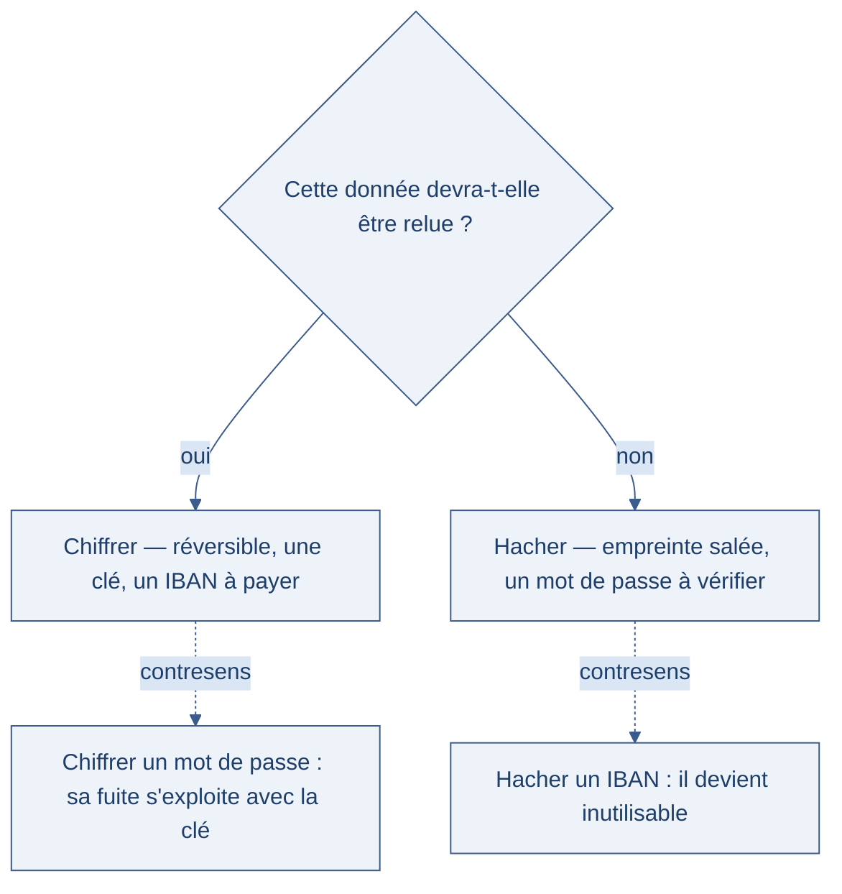
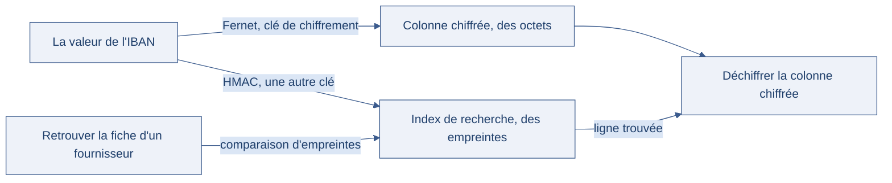

[← Chapitre précédent](08-pki-et-certificats.md) · [Sommaire](Readme.md) · [Chapitre suivant →](10-secrets.md)

# Données au repos

> Un ordinateur portable est volé dans un train. Il contient le dossier de patients
> d'un cabinet médical : noms, coordonnées, comptes rendus. Si le disque est chiffré,
> le voleur repart avec un morceau de métal ; s'il ne l'est pas, il repart avec la vie
> privée de centaines de personnes. Le vol est un fait **physique** — hors du périmètre
> de ce cours ; la réponse **logicielle**, elle, tient en un mot : chiffrer ce qui
> repose.

**Durée de lecture :** 50 min hors approfondissements facultatifs · **Prérequis :** le chiffrement symétrique et la
gestion des clés (journée précédente)

---

## Objectifs

À l'issue de ce chapitre, vous serez capable de :

- **Distinguer** ce que protège le chiffrement de disque de ce que protège le
  chiffrement applicatif d'une colonne.
- **Choisir** le niveau de chiffrement adapté à chaque catégorie de données au repos.
- **Chiffrer** une colonne sensible d'une base de données depuis l'application.
- **Sécuriser** une sauvegarde et vérifier qu'elle est réellement restaurable.

---

## I. Chiffrement de disque

### Le premier niveau

Le **chiffrement de disque** (ou chiffrement au repos, *encryption at rest*) chiffre
l'intégralité d'un volume : le système d'exploitation le déchiffre à la volée quand il
lit un bloc, et le rechiffre à l'écriture. Pour l'utilisateur, rien ne change ; pour
quiconque démonte le disque, tout est illisible.

Trois implémentations courantes :

| Outil | Plateforme | Principe |
| --- | --- | --- |
| **BitLocker** | Windows | Chiffrement de volume, clé liée à la puce TPM de la machine |
| **LUKS** (*Linux Unified Key Setup*) | Linux | Volume chiffré géré par `cryptsetup`, ouvert par une phrase de passe |
| **FileVault** | macOS | Chiffrement de disque intégré au système |

Le chiffrement de disque répond à un scénario précis : **le support sort de son
environnement** — vol, revente de matériel, machine envoyée en réparation, disque
d'un serveur mis au rebut. C'est un rempart efficace, et souvent gratuit à activer.

### Ce qu'il ne protège pas

Le volume est déchiffré **tant que la machine tourne** : un attaquant qui arrive sur
une session ouverte, un malware exécuté avec les droits de l'utilisateur ou un
administrateur légitime lisent exactement la même chose qu'avant.

> [!WARNING]
> Le chiffrement de disque protège le **support**, pas la **donnée**. Toute copie qui
> en sort — dump SQL, CSV envoyé par courriel, sauvegarde, réplication — repart sans
> protection. C'est pour cette raison que la suite du chapitre traite la donnée
> elle-même.

Un point pratique qui décide de tout : **la clé de récupération**. Une phrase de passe
perdue ou une clé de récupération rangée dans le même tiroir que le portable, et le
chiffrement se retourne contre vous — les données sont perdues pour tout le monde, y
compris pour vous. La clé de récupération se range ailleurs : coffre, gestionnaire de
secrets, enveloppe scellée chez un responsable.

---

## II. Chiffrement de colonne

### Quand le disque ne suffit plus

Une base de données contient des informations dont la sensibilité dépasse celle du
serveur qui les héberge : coordonnées bancaires (IBAN, *International Bank Account
Number*), numéros d'identification, données de santé, historiques d'achats.

Le **chiffrement de colonne** déplace la protection au plus près de la donnée :
l'application chiffre la valeur avant de l'écrire, et la déchiffre à la lecture. La
base ne stocke que du chiffré — un dump de la table ne livre rien.

### Chiffrer, ou hacher : la question à poser avant

Toutes les données sensibles ne se traitent pas de la même façon :

- **Chiffrer** quand la donnée doit être **relue** : un IBAN pour payer un
  fournisseur, une adresse pour livrer. Le chiffrement est réversible, avec une clé.
- **Hacher** quand la donnée ne doit être que **reconnue** : un mot de passe se
  compare, il ne se relit jamais. On stocke une empreinte salée, jamais la valeur.

Confondre les deux est coûteux : chiffrer un mot de passe rend sa fuite exploitable
par quiconque détient la clé, et hacher un IBAN le rend inutilisable.

L'arbre ci-dessous réduit ce choix à la seule question qui tranche, et montre les deux
contresens côte à côte.



Ce n'est donc jamais la réputation de la technique qui décide, mais l'usage de la donnée.
Une seule question, et elle se pose avant d'écrire la première ligne.

### En pratique, côté application

Le principe tient en quelques lignes — la bibliothèque `cryptography` de Python
fournit des primitives prêtes à l'emploi :

```python
from cryptography.fernet import Fernet
import os

# La clé vient de l'environnement, jamais du code source.
CLE = os.environ["CLE_CHIFFREMENT"]
f = Fernet(CLE)

def chiffrer(valeur: str) -> bytes:
    """Chiffre une valeur sensible avant écriture en base."""
    return f.encrypt(valeur.encode("utf-8"))

def dechiffrer(stocke: bytes) -> str:
    """Déchiffre une valeur lue en base."""
    return f.decrypt(stocke).decode("utf-8")
```

Trois règles se dégagent de ce schéma :

1. **La clé ne vit pas dans le code.** Elle vient d'une variable d'environnement ou
   d'un gestionnaire de secrets — le chapitre suivant est entièrement consacré à ce
   point.
2. **Chaque écriture produit un chiffré différent.** Les algorithmes modernes
   intègrent un nombre aléatoire (un *nonce*) par message : deux IBAN identiques ne
   donnent pas deux fois la même valeur stockée, ce qui limite ce qu'un observateur
   de la base peut deviner.
3. **La colonne change de nature.** Elle stocke désormais des octets chiffrés :
   plus de `LIKE`, plus de tri, plus de jointure sur cette colonne.

### Le problème de la recherche

Une colonne chiffrée ne se consulte plus. Pour retrouver « la fiche du fournisseur
dont l'IBAN est celui-ci », deux approches :

- **déchiffrer et comparer** : simple, mais linéaire — la base ne peut pas indexer ;
- l'**index aveugle** : on stocke à côté une empreinte de recherche, par exemple un
  HMAC (code d'authentification par hachage) de la valeur calculé avec une **autre
  clé**. La recherche se fait sur l'empreinte, la lecture sur le chiffré.

L'index aveugle révèle les **égalités** (deux lignes qui partagent la même valeur) —
c'est un compromis assumé, à documenter.

Le schéma ci-dessous assemble le dispositif avant l'exercice, qui vous le fera écrire : deux
clés, deux colonnes, deux chemins de retour.



La recherche passe par l'index, la lecture par le chiffré, et les deux clés restent
séparées : une fuite de la clé d'index ne doit pas livrer de quoi déchiffrer. Ce que
l'index concède, lui, est dans le texte ci-dessus — les égalités se voient sans la clé.

> 🧪 **Atelier rapide (8 min)**
>
> Ouvrez la base de démonstration du lab et regardez ce qu'elle stocke réellement :
>
> ```bash
> mysql -h localhost -u root -proot fromagerie
> ```
>
> puis, dans le client MySQL :
>
> ```sql
> SHOW TABLES;
> DESCRIBE users;
> SELECT username, password_hash FROM users LIMIT 5;
> ```
>
> Parmi les colonnes des tables `users`, `products`, `comments` et `orders`, lesquelles
> mériteraient un chiffrement applicatif, lesquelles un simple hachage, et lesquelles
> aucune protection particulière ? Notez votre classement : l'exercice du bloc y
> revient.

---

### Exercice 1 — Chiffrer une colonne sensible (1 h)

#### Contexte

**Novéo RH** édite un logiciel de paie. Les coordonnées bancaires des salariés sont
stockées en clair dans la table `employes` de la base MySQL de production :

```sql
CREATE TABLE employes (
    id INT PRIMARY KEY,
    nom VARCHAR(64) NOT NULL,
    email VARCHAR(128) NOT NULL,
    iban VARCHAR(34) NOT NULL
);

INSERT INTO employes (id, nom, email, iban) VALUES
    (1, 'Claire Fontaine', 'claire.fontaine@noveo-rh.fr', 'FR76 3000 4008 2800 0123 4567 890'),
    (2, 'Marc Delaunay',   'marc.delaunay@noveo-rh.fr',   'FR14 2004 1010 0505 0001 3M02 606'),
    (3, 'Inès Berthier',   'ines.berthier@noveo-rh.fr',   'FR76 3000 6000 0112 3456 7890 189');
```

L'audit de conformité est formel : les IBAN doivent être **chiffrés au niveau
applicatif**. Le disque du serveur est déjà chiffré, mais la base est copiée tous les
soirs, exportée pour le support, et lue par plusieurs administrateurs. L'application
est écrite en Python ; la bibliothèque `cryptography` est disponible dans
l'environnement.

#### Consignes

##### Partie 1 — Choisir la stratégie

Répondez par écrit, en quelques phrases :

1. Pourquoi le chiffrement de disque ne suffit-il pas dans cette situation ?
2. Pourquoi chiffrer l'IBAN plutôt que le hacher — alors que le hachage est jugé
   « plus sûr » par une partie de l'équipe ?
3. Que faire des colonnes `nom` et `email`, qui sont aussi des données personnelles ?
   Donnez votre position et ses limites.

##### Partie 2 — Chiffrer et déchiffrer

Écrivez un module Python qui :

1. lit la clé de chiffrement dans la variable d'environnement `CLE_CHIFFREMENT` —
   jamais dans le code ;
2. expose `chiffrer(valeur: str) -> bytes` et `dechiffrer(stocke: bytes) -> str` ;
3. chiffre les IBAN existants de la table (migration) et les stocke dans une colonne
   adaptée au format binaire ;
4. déchiffre une fiche à la lecture.

Testez votre module sur les trois lignes fournies : après migration, la base ne doit
plus contenir aucun IBAN lisible.

##### Partie 3 — Traiter la clé

Décrivez en une dizaine de lignes :

1. où la clé est générée, où elle est stockée, qui y a accès ;
2. ce qui se passe concrètement si la clé est perdue ;
3. comment remplacer la clé par une nouvelle **sans interruption de service**.

##### Partie 4 — Retrouver une fiche

La paie doit pouvoir retrouver un salarié à partir de son IBAN. Comme la colonne
chiffrée n'est plus interrogeable, ajoutez une colonne `iban_index` et une fonction de
recherche qui l'utilise. Expliquez en deux phrases ce que cette colonne révèle malgré
tout à qui lit la base.

#### Attendu

Un module Python exécutable (chiffrement, migration, recherche) et un court rapport —
une dizaine de lignes suffisent — pour les parties 1, 3 et 4, relié à l'implémentation.

#### ✅ Auto-évaluation

Avant de passer au corrigé, vérifiez que :

- [ ] J'ai expliqué pourquoi le chiffrement de disque ne couvre pas les copies de la base.
- [ ] J'ai justifié le choix chiffrement / hachage pour l'IBAN, en m'appuyant sur le besoin de le **relire**.
- [ ] Ma clé vient d'une variable d'environnement et n'apparaît nulle part dans le code ni dans la base.
- [ ] Après migration, une requête `SELECT` sur la table ne montre aucun IBAN lisible.
- [ ] Ma fonction de recherche trouve la bonne fiche à partir d'un IBAN complet.
- [ ] J'ai écrit ce que révèle la colonne `iban_index`, et pourquoi c'est un compromis assumé.

#### Prolongement de l'exercice

*Facultatif.* Mesurez le coût de votre solution : chronométrez la lecture de dix
mille fiches avec et sans chiffrement, puis la recherche par index. À partir de quel
ordre de grandeur le chiffrement applicatif devient-il un sujet de performance — et
que feriez-vous si ce seuil était atteint en production ?

<details>
<summary>Voir la correction</summary>

#### Partie 1 — Choisir la stratégie

**Éléments attendus :**

**1. Pourquoi le chiffrement de disque ne suffit pas.** Il protège le volume de la
machine, pas les copies qui en sortent : la sauvegarde du soir, l'export de support,
la réplication, la session d'un administrateur qui ouvre un client SQL. Toutes ces
voies livrent la colonne en clair, quel que soit l'état du disque. Le chiffrement
applicatif protège la **valeur** elle-même, où qu'elle aille.

**2. Pourquoi chiffrer plutôt que hacher.** La paie doit **relire** l'IBAN pour
ordonner le virement : le hachage est à sens unique, il rendrait la donnée
inutilisable. Le hachage convient quand on veut seulement **reconnaître** une valeur
(un mot de passe, par exemple) ; ici, le besoin est de la restituer. « Plus sûr » n'a
de sens que rapporté à un usage : un hachage appliqué à une donnée à relire est une
perte de données, pas une sécurité.

**3. Nom et email.** Ce sont des données personnelles, mais leur sensibilité n'est pas
la même que celle d'un IBAN. Position défendable : les garder lisibles pour le
fonctionnement courant, limiter strictement qui les consulte, tracer les accès, et
**minimiser** — ne stocker que ce qui sert réellement. Chiffrer l'email, par exemple,
est possible, mais cela casse les notifications et les recherches : l'arbitrage se
fait au cas par cas, en documentant ce que l'on choisit de ne pas protéger et pour
quelle raison.

#### Partie 2 — Chiffrer et déchiffrer

**Éléments attendus :** un module qui refuse de démarrer sans clé, chiffre à
l'écriture, déchiffre à la lecture, et migre les lignes existantes.

```python
"""Chiffrement applicatif de la colonne iban — Novéo RH."""
import hashlib
import hmac
import os

from cryptography.fernet import Fernet

def charger_cle() -> Fernet:
    """Lit la clé dans l'environnement ; refuse de démarrer sans elle."""
    cle = os.environ.get("CLE_CHIFFREMENT")
    if not cle:
        raise RuntimeError("Variable CLE_CHIFFREMENT absente : refus de démarrer.")
    return Fernet(cle.encode("utf-8"))

def normaliser(iban: str) -> str:
    """Retire les espaces et passe en majuscules : la forme stockée est unique."""
    return iban.replace(" ", "").upper()

def chiffrer(f: Fernet, valeur: str) -> bytes:
    """Chiffre une valeur sensible avant écriture en base."""
    return f.encrypt(normaliser(valeur).encode("utf-8"))

def dechiffrer(f: Fernet, stocke: bytes) -> str:
    """Déchiffre une valeur lue en base."""
    return f.decrypt(stocke).decode("utf-8")
```

La migration s'écrit en trois temps — ajouter, remplir, puis retirer :

```python
def migrer(conn) -> None:
    f = charger_cle()
    conn.execute("ALTER TABLE employes ADD COLUMN iban_chiffre BLOB")
    conn.execute("ALTER TABLE employes ADD COLUMN iban_index TEXT")

    for id_, iban in conn.execute("SELECT id, iban FROM employes").fetchall():
        conn.execute(
            "UPDATE employes SET iban_chiffre = ?, iban_index = ? WHERE id = ?",
            (chiffrer(f, iban), index_recherche(iban), id_),
        )
    conn.commit()

    # Vérifier la relecture de chaque ligne AVANT de supprimer l'ancienne colonne.
    for id_, iban in conn.execute("SELECT id, iban FROM employes").fetchall():
        lu = conn.execute(
            "SELECT iban_chiffre FROM employes WHERE id = ?", (id_,)
        ).fetchone()[0]
        assert dechiffrer(f, lu) == normaliser(iban)

    conn.execute("ALTER TABLE employes DROP COLUMN iban")
    conn.commit()
```

**Ce qu'il faut retenir :** la normalisation (`normaliser`) n'est pas un détail. Les
IBAN sont saisis avec ou sans espaces ; si l'on chiffre la forme brute, deux écritures
du même compte donnent deux valeurs différentes, et la recherche de la partie 4
échouera sur une ligne sur deux. On fixe **une** forme, avant de chiffrer comme avant
d'indexer.

**Erreurs fréquentes :** supprimer l'ancienne colonne avant d'avoir vérifié la
relecture — en cas d'erreur de format, les données sont perdues avec elle. La bonne
ordre est : ajouter, remplir, **vérifier**, retirer. Et pendant toute la migration, la
sauvegarde de secours reste chiffrée et séparée de la clé.

#### Partie 3 — Traiter la clé

**Éléments attendus :**

1. **Génération et stockage.** La clé se génère une fois, dans un environnement de
   confiance (`Fernet.generate_key()` ou, mieux, un coffre de secrets). Elle se stocke
   dans un gestionnaire de secrets ou une variable d'environnement injectée au
   démarrage — jamais dans le dépôt, jamais dans la base, jamais dans une image
   Docker. L'accès est limité à l'identité d'exécution de l'application.
2. **Perte de la clé.** Les données chiffrées deviennent illisibles : c'est une perte
   sèche, pas une indisponibilité temporaire. D'où l'obligation d'une **clé de
   secours** rangée ailleurs que la base (coffre, enveloppe scellée, responsable
   désigné) — et d'un exercice de restauration qui prouve qu'elle fonctionne.
3. **Remplacement sans interruption.** On procède par période à deux clés : la
   nouvelle clé chiffre les écritures, l'ancienne reste active pour le déchiffrement ;
   on migre les lignes progressivement, puis on désactive l'ancienne. Pour distinguer
   les deux, on versionne le chiffré — une colonne `cle_id` ou un préfixe dans la
   valeur stockée — afin que la lecture sache quelle clé employer.

#### Partie 4 — Retrouver une fiche

**Éléments attendus :**

```python
def index_recherche(valeur: str) -> str:
    """Index aveugle : empreinte de recherche, calculée avec une clé distincte."""
    cle_index = os.environ["CLE_INDEX"].encode("utf-8")
    return hmac.new(cle_index, normaliser(valeur).encode("utf-8"), hashlib.sha256).hexdigest()

def trouver_par_iban(conn, iban: str):
    """Retrouve une fiche à partir d'un IBAN, sans jamais lire la colonne chiffrée."""
    f = charger_cle()
    ligne = conn.execute(
        "SELECT id, nom, email, iban_chiffre FROM employes WHERE iban_index = ?",
        (index_recherche(iban),),
    ).fetchone()
    if ligne is None:
        return None
    id_, nom, email, iban_chiffre = ligne
    return {"id": id_, "nom": nom, "email": email, "iban": dechiffrer(f, iban_chiffre)}
```

**Ce que révèle l'index :** deux salariés qui partagent le même IBAN produisent le
même `iban_index` — un lecteur de la base voit donc les **égalités** entre lignes,
même sans la clé. Et si la clé `CLE_INDEX` vient à fuiter, un attaquant peut tester
des IBAN candidats et confirmer lesquels sont présents. C'est un compromis assumé :
l'index rend la recherche possible, au prix d'une fuite limitée sur les
répétitions. La mitigation simple : une clé d'index distincte de la clé de
chiffrement, et le même niveau de protection pour les deux.

**Erreurs fréquentes :** réutiliser la même clé pour chiffrer et pour indexer. Les
deux usages sont différents — l'une protège la confidentialité, l'autre sert de
signature de recherche — et une fuite de l'index ne doit pas livrer le déchiffrement.

#### Points à retenir

- Le chiffrement applicatif protège la donnée **là où elle va** : sauvegarde, export,
  réplication — pas seulement sur le disque.
- **Chiffrer pour relire, hacher pour reconnaître** : l'usage décide, jamais la
  réputation de la technique.
- La clé vit hors du code et hors de la base ; sa **perte** est aussi grave qu'une
  fuite — d'où la clé de secours et l'exercice de restauration.
- La migration suit un ordre strict : ajouter, remplir, **vérifier**, retirer.
- La recherche sur colonne chiffrée passe par un **index aveugle** qui révèle les
  égalités : compromis documenté, clé distincte, jamais improvisé.

</details>

---

## III. Sauvegardes

### La cible préférée

Une sauvegarde est, par construction, **tout le système au même endroit**. C'est ce
qui en fait la cible favorite : un seul accès, et l'attaquant repart avec des années
de données — y compris celles que l'on a prises soin de chiffrer ailleurs, si la
sauvegarde contient aussi les clés. Trois principes :

- **Chiffrer la sauvegarde elle-même**, avec un outil qui le fait nativement (les
  outils de sauvegarde modernes chiffrent à la volée) ou un conteneur chiffré.
- **Séparer la clé de la sauvegarde.** Une sauvegarde chiffrée dont la clé est jointe
  au même disque n'est pas chiffrée, elle est décorée. La clé se range dans un autre
  lieu, un autre système, une autre autorité.
- **Rendre la sauvegarde immuable** quand c'est possible : une copie que ni le
  ransomware ni un administrateur pressé ne peut écraser ou supprimer.

### La restauration, seule preuve qui compte

Une sauvegarde non testée est une hypothèse. Le chiffrement ajoute un mode de défaillance
de plus : la clé perdue, le format oublié, le mot de passe de la phrase de passe
consigné nulle part. La seule preuve qu'une sauvegarde protégée est utilisable est un
**exercice de restauration** — périodique, daté, documenté, sur une machine qui n'est
pas celle de production.

> [!TIP]
> Adoptez le rythme simple : restaurer un échantillon à chaque changement majeur de
> la chaîne de sauvegarde, et une restauration complète au moins une fois par an. Notez
> la durée réelle de la restauration — c'est elle qui décide du temps d'indisponibilité
> en cas d'incident, pas la vitesse de la sauvegarde.

---

## IV. Aller plus loin

🔁 **Pour aller plus loin (facultatif)** — à lire si le créneau le permet, rien
d'obligatoire n'en dépend.

- **Confidentialité permanente** (*forward secrecy*) : dans les protocoles modernes
  comme TLS 1.3, la clé de session est **éphémère** — elle est calculée pour la
  session puis détruite. Un attaquant qui enregistre le trafic chiffré aujourd'hui et
  vole la clé privée du serveur demain ne peut pas déchiffrer le passé : les clés de
  session n'existent plus. C'est la différence entre « protégé tant que la clé tient »
  et « protégé pour toujours ».
- **Chiffrement par enveloppe** : la donnée est chiffrée par une clé de données, qui
  est elle-même chiffrée par une clé maître rangée dans un coffre (KMS, *Key
  Management Service*, ou module de sécurité matériel). On peut alors tourner la clé
  maître sans rechiffrer la base entière.
- **Le coût du chiffrement applicatif** : chaque lecture devient une opération
  cryptographique, chaque recherche un compromis. Le chapitre sur les compromis
  sécurité / performance de cette journée chiffre ce que cela représente.

---

## Points clés

- Le chiffrement de disque protège le **support** : vol, revente, mise au rebut. Il
  ne protège rien dès qu'une copie sort du volume.
- Le chiffrement de colonne protège la **donnée** elle-même, y compris dans un dump,
  une réplication ou un export.
- **Chiffrer** pour relire, **hacher** pour reconnaître — jamais l'inverse.
- Une colonne chiffrée ne se recherche plus : l'index aveugle (HMAC) est le compromis
  usuel, à documenter.
- Une sauvegarde se chiffre, se sépare de sa clé, et se **teste** : la restauration est
  la seule preuve qu'elle existe.

---

## 🧠 Vérifiez vos acquis

*Formatif, jamais noté. Répondez sans relire le chapitre, puis dépliez « Vérifier ses réponses ». Ce qui compte est de repérer où vous vacillez, pas de faire 5 sur 5.*

**1.** Le portable d'un salarié, dont le disque est chiffré, est compromis alors que sa session est ouverte et qu'un malware s'exécute avec ses droits. Que lit l'attaquant ?

- A. Rien : le disque est chiffré, et le malware ne voit que des blocs illisibles
- B. Exactement la même chose qu'avant : le volume est déchiffré tant que la machine tourne
- C. Uniquement les fichiers ouverts au moment de l'intrusion, les autres restant chiffrés sur le disque
- D. Les fichiers, mais sans les métadonnées : celles-ci restent protégées par le chiffrement du volume

**2.** Dans la base de DIGICHEESE, comment traiter respectivement l'IBAN d'un fournisseur et le mot de passe d'un client ?

- A. Les deux chiffrés, pour pouvoir les relire en cas de besoin, avec une clé propre à chaque table
- B. Les deux hachés avec un sel commun, pour ne jamais stocker la valeur elle-même en base
- C. L'IBAN chiffré (il doit être relu), le mot de passe haché (il doit être reconnu, jamais relu)
- D. L'IBAN haché, le mot de passe chiffré : ce sont les deux données les plus sensibles de la table

**3.** Une colonne « IBAN » passe en chiffrement applicatif. Que constate-t-on ensuite ?

- A. Les requêtes fonctionnent comme avant, seules les écritures ralentissent
- B. La colonne change de nature : plus de `LIKE`, plus de tri, plus de jointure dessus
- C. Deux IBAN identiques donnent la même valeur stockée, ce qui facilite la recherche
- D. La base peut indexer la colonne chiffrée comme n'importe quelle colonne

**4.** Quelle affirmation sur les sauvegardes est correcte ?

- A. Une sauvegarde chiffrée dont la clé est sur le même disque reste chiffrée : les deux sont distincts
- B. Une sauvegarde non testée est une hypothèse : seule une restauration périodique, datée et documentée prouve qu'elle est utilisable
- C. Le chiffrement de la sauvegarde dispense de la rendre immuable : un ransomware ne peut pas y toucher
- D. C'est la vitesse de la sauvegarde qui décide du temps d'indisponibilité en cas d'incident, pas la restauration

**5.** *Question ouverte (2-3 lignes).* Il faut quand même pouvoir retrouver « la fiche du fournisseur dont l'IBAN est celui-ci ». Quel compromis le cours propose-t-il, comment fonctionne-t-il, et que révèle-t-il ?

---

<details>
<summary>Vérifier ses réponses</summary>

### Réponses

**1. B.** Le chiffrement de disque protège le **support**, pas la **donnée** : le système déchiffre à la volée à la lecture.
**Pourquoi :** il répond au scénario « le support sort de son environnement » — vol, revente, réparation, mise au rebut. Toute copie qui sort du volume (dump SQL, CSV par courriel, sauvegarde, réplication) repart sans protection.

**2. C.** Chiffrer quand la donnée doit être **relue**, hacher quand elle ne doit être que **reconnue** — jamais l'inverse.
**Pourquoi :** chiffrer un mot de passe rend sa fuite exploitable par quiconque détient la clé ; hacher un IBAN le rend inutilisable.

**3. B.** La colonne stocke désormais des octets chiffrés et ne se consulte plus. En revanche, chaque écriture produit un chiffré différent : les algorithmes modernes intègrent un *nonce* par message, donc deux IBAN identiques ne donnent pas deux fois la même valeur stockée.
**Pourquoi :** c'est ce qui limite ce qu'un observateur de la base peut deviner — et la clé doit venir de l'environnement, jamais du code source.

**4. B.** Une sauvegarde se chiffre, se **sépare** de sa clé (autre lieu, autre système, autre autorité — sinon elle est décorée, pas chiffrée), et se **teste**.
**Pourquoi :** le chiffrement ajoute des modes de défaillance (clé perdue, format oublié) ; et c'est la **durée réelle de la restauration**, pas la vitesse de la sauvegarde, qui décide du temps d'indisponibilité.

**5.** Attendu : l'**index aveugle** — on stocke à côté une empreinte de recherche, par exemple un HMAC de la valeur calculé avec une **autre clé** ; la recherche se fait sur l'empreinte, la lecture sur le chiffré (l'autre approche, déchiffrer et comparer, est linéaire car la base ne peut pas indexer).
**Pourquoi :** l'index aveugle révèle les **égalités** — deux lignes qui partagent la même valeur. C'est un compromis assumé, à documenter.

</details>

---

[← Chapitre précédent](08-pki-et-certificats.md) · [Sommaire](Readme.md) · [Chapitre suivant →](10-secrets.md)
